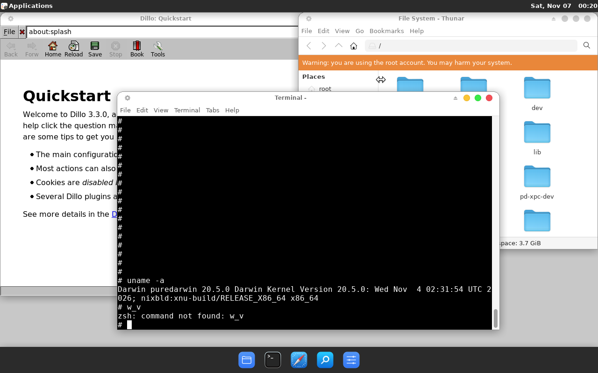
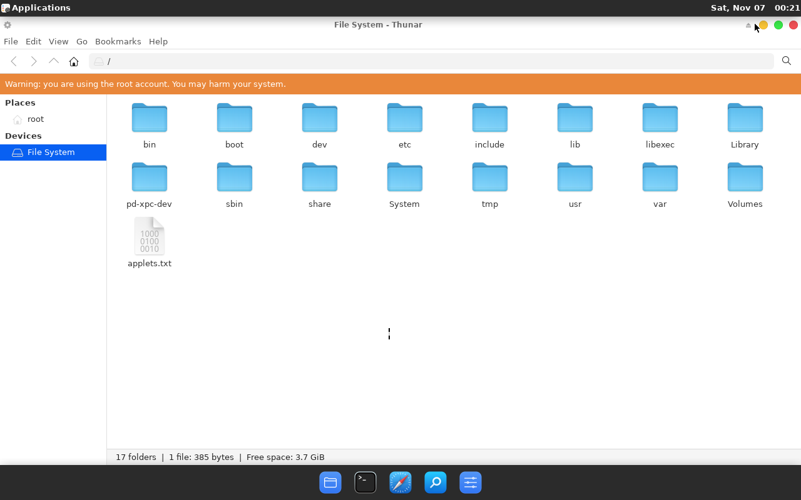

# xpkg : gestionnaire de paquets (façon apt) pour les kits XFCE/macOS

Sans dpkg : seulement `sh` et `curl`. Index **signé** (Ed25519).

## Installer

    curl -fsSL https://leo-76.github.io/xpkg/xpkg -o /usr/local/bin/xpkg && chmod +x /usr/local/bin/xpkg
    xpkg update
    xpkg list
    xpkg install xfce-macos-3

Commandes : `update | list | search MOT | show PAQ | install PAQ... | remove PAQ... | files PAQ | status`.

## Sécurité

- `index.sig` signe `index` (clé publique Ed25519 intégrée dans le script `xpkg`, aussi dans `xpkg.pub`).
- `xpkg update` vérifie la signature avec `openssl`. Index modifié = refusé.
- Si `openssl` est absent ou trop ancien (sans Ed25519) : simple avertissement, l'installation n'est **pas** bloquée. `XPKG_STRICT=1` rend la vérification obligatoire.
- Le SHA256 de chaque paquet (listé dans l'index signé) est toujours vérifié avant exécution.
- Empreinte à comparer : `openssl pkey -pubin -in xpkg.pub -outform DER | openssl sha256`.

## Testé / non testé

Testé (Mac, HOME temporaire, serveur HTTP local) : update signé, index falsifié refusé, mode sans openssl (avertissement) et strict (refus), install/status/remove de `xfce-macos-1`.
Non testé : depuis GitHub Pages en HTTPS sur PureDarwin, rendu XFCE sur PureDarwin. Rendu validé seulement sur Debian 13 + XFCE + Plank + X11 (voir Leo-76/xfce-apt).

Après modification de `index` ou `pkgs/` : `openssl pkeyutl -sign -inkey CLE.key -rawin -in index -out index.sig`.

## PureDarwin (captures)

Système cible : PureDarwin 20.5.0 (XNU, `uname -a` testé dans le terminal ; barre « Applications », dock à 5 icônes).
`xpkg` n'y a **pas encore été lancé** (saisie clavier automatique peu fiable dans QEMU) : seules ces deux captures du système sont réelles.

